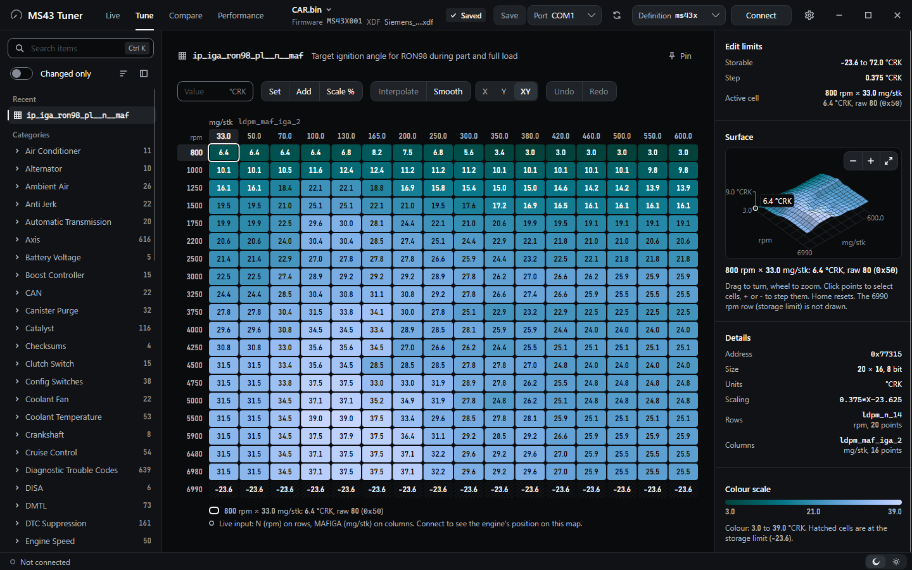
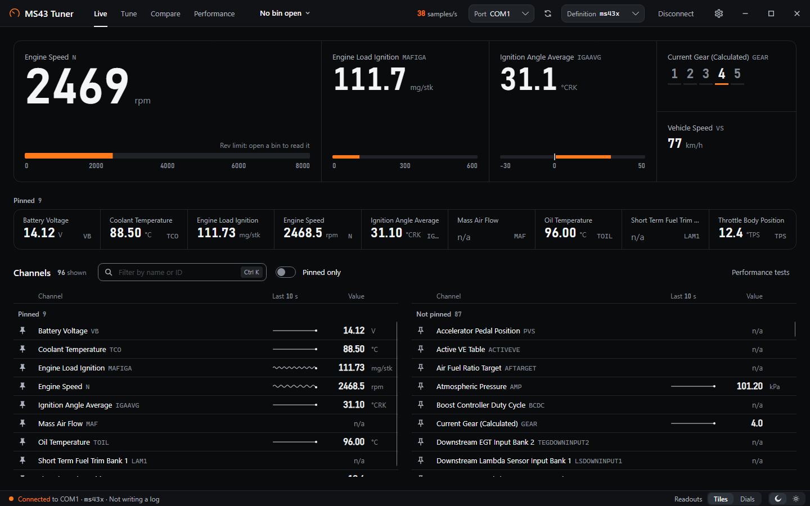
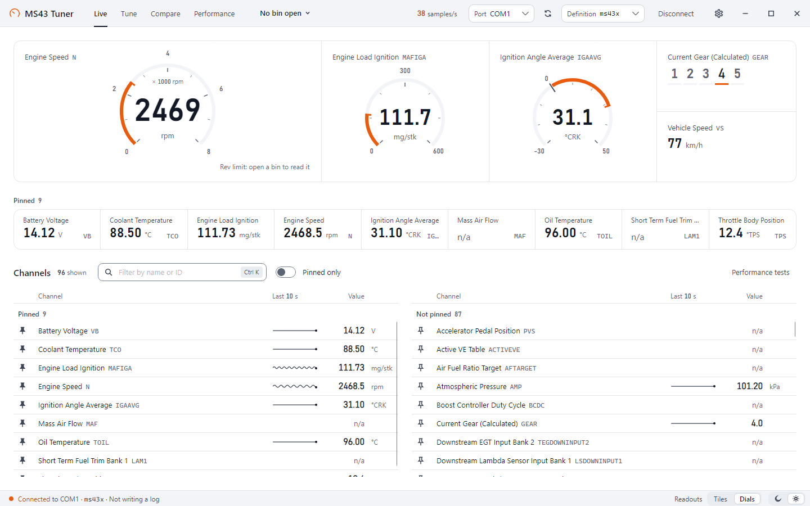
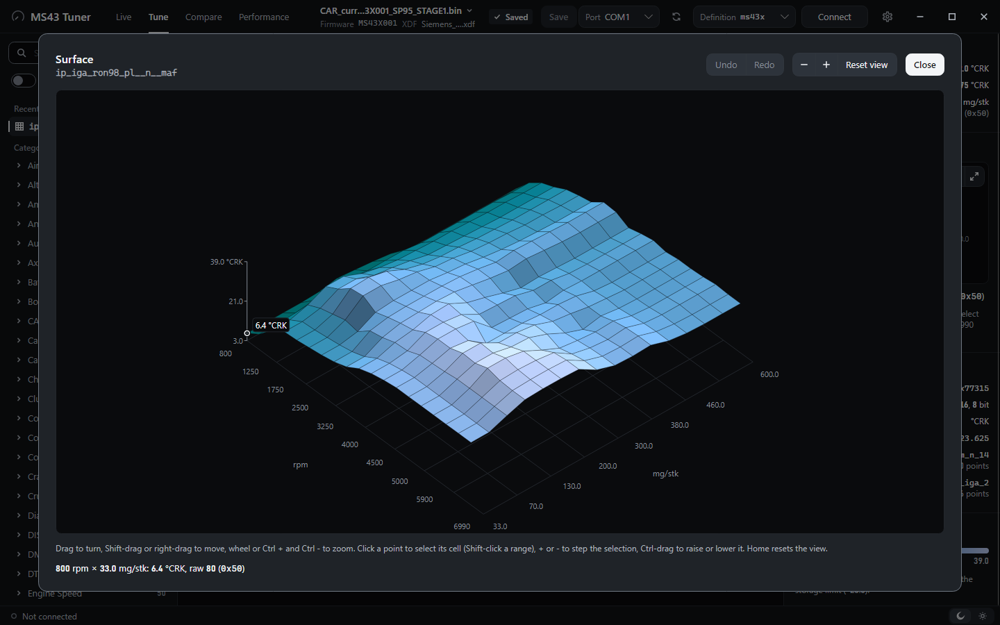
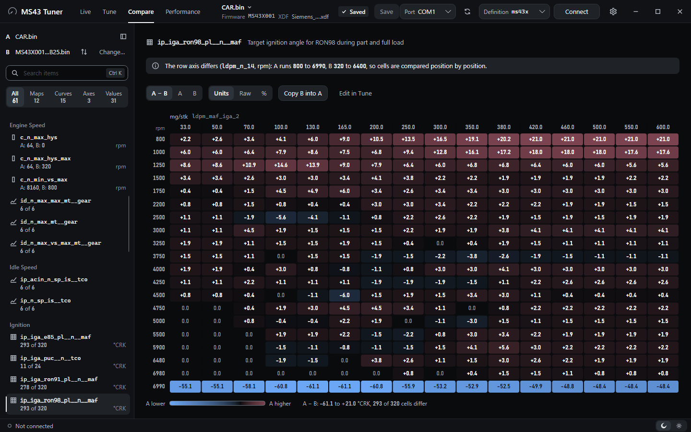
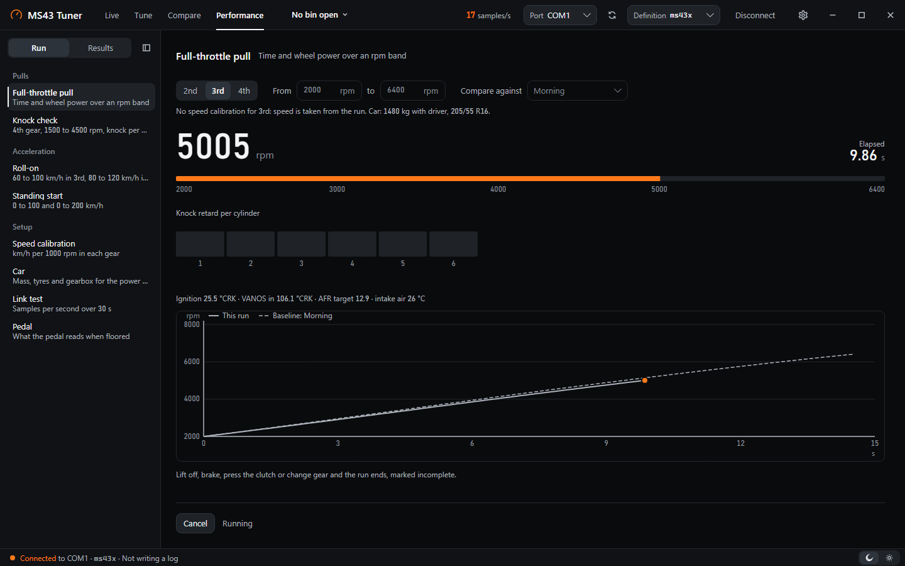
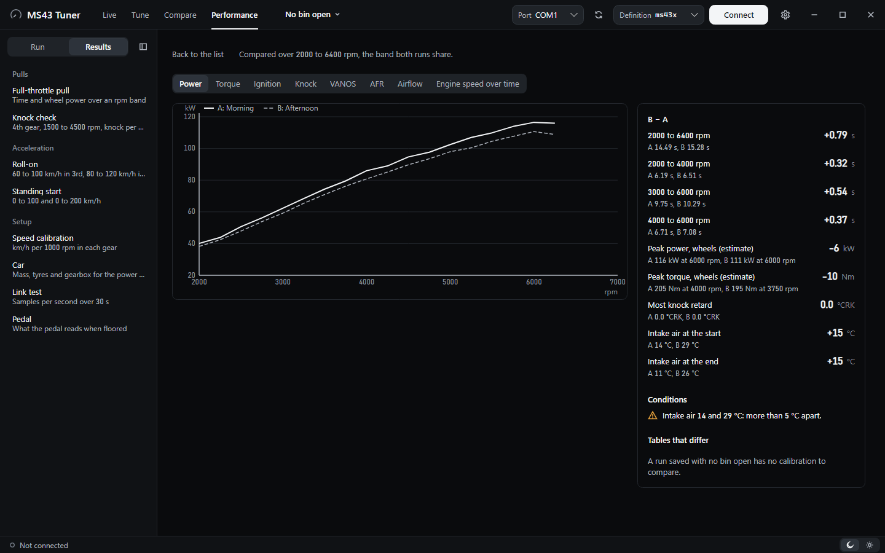

<div align="center">


# MS43 Tuner

**Live logging, map editing, bin compare and road performance tests for the Siemens MS43 ECU.**

A Windows desktop app, with a command-line tool next to it, for BMW's M54B22, M54B25 and M54B30 engines,<br>
on stock MS430069-family software or on MS43X001, the community firmware from the MS4X project.

[](https://github.com/raph559/MS43_TUNER/actions/workflows/ci.yml)
[](LICENSE)
[](https://dotnet.microsoft.com/)
[](#what-you-need)

[What it does](#what-it-does) · [What you need](#what-you-need) · [Install](#install) · [First steps](#first-steps) · [Command line](#command-line-tool) · [Build and test](#build-and-test)

</div>

<br>



> [!WARNING]
> MS43 Tuner never writes ECU flash. It saves edited bin files on your PC, and you flash them yourself with MS4X Flasher, which also corrects the checksum. Wheel power is an estimate, not a dyno figure. Run performance tests only on a closed road or a track.

## What it does

The window has four tabs: Live, Tune, Compare and Performance. There are Night and Day themes (or follow Windows), and animations follow the Windows animation setting.

### Live

Watch the engine over DS2 on the K-line, and keep a CSV log of it.

<table>
  <tr>
    <td width="50%"></td>
    <td width="50%"></td>
  </tr>
  <tr>
    <td align="center"><sub>Night theme, tiles</sub></td>
    <td align="center"><sub>Day theme, dials</sub></td>
  </tr>
</table>

- Connects through a K+DCAN USB cable and polls the MS4X logging command, using the bundled definition for your engine or firmware.
- Shows the main values as large tiles or dials, a row of pinned channels, and every channel in a list with a sparkline of the last 10, 30 or 60 seconds. Filter the list by name or ID with Ctrl K.
- Reads the rev limit from the open bin and marks it on the rpm readout.
- Writes a CSV log, on demand or as soon as you connect. The header shows the measured samples per second.
- Warns in red while the coolant is cold and in amber until the oil is warm.

### Tune

Open a bin with its TunerPro XDF and edit it, as a grid (the picture at the top of this page) or as a surface.

<p align="center">
  <br>
  <sub>The ignition map as a 3D surface</sub>
</p>

- Opens a 512 KiB bin with a TunerPro XDF, reads the firmware ID from the bin, and remembers which XDF goes with which firmware.
- Lists every XDF item in a rail by category, with search, recent items, pins and a "Changed only" filter.
- Edits maps in physical units or raw values: set, add, scale by a percentage, interpolate and smooth along X, Y or both, with undo and redo. The storable range and step of each item are shown next to the grid.
- Draws maps as a 3D surface you can turn, zoom and edit (Ctrl-drag a point to raise or lower it). Curves, single values, switches and flags each have their own view.
- Live cursor: while connected, the map shows the cell the engine is on and whether the ECU is using that map right now.
- Saves the bin, keeping a `.bak` copy of the file as it was before the first save and adding your changes to an edit log next to it, in TunerPro format. Both are on by default and can be turned off in Settings.

### Compare

Put a second bin next to yours and see every value that differs.

<p align="center">
  <br>
  <sub>B − A for the ignition map, in units</sub>
</p>

- Opens a second bin (B) against the one you are tuning (A) and lists only the items that differ, with how many cells differ in each.
- Shows B − A in units, raw counts or percent, or either file on its own, with a colour scale for where B is higher or lower.
- Copies cells or whole items from B into A. The copy is an ordinary edit: undo it, or save A as usual.
- Lists the bytes that differ outside every XDF item, so nothing is hidden.

### Performance

Time pulls, roll-ons and standing starts from the same data stream.

<table>
  <tr>
    <td width="50%"></td>
    <td width="50%"></td>
  </tr>
  <tr>
    <td align="center"><sub>A pull in progress</sub></td>
    <td align="center"><sub>Two saved runs compared</sub></td>
  </tr>
</table>

<sub>Both runs are simulated: a stock M54B25 in 3rd, its rise worked out from BMW's torque figures, with the engine readings following a real car's map and log.</sub>

- Full-throttle pull in 2nd, 3rd or 4th over an rpm band: times across the band, estimated wheel power and torque, knock retard per cylinder, intake air temperature at the start and the end.
- Knock check in 4th gear, roll-ons from 60 to 100 and 80 to 120 km/h, and standing starts with 0 to 100, 0 to 200 and 100 to 200 km/h times.
- Setup items: speed calibration per gear (with an optional correction from a phone's GPS speed), car values for the power estimate (mass, tyres, gearbox), a pedal check and a link test.
- Red coolant and amber oil warm-up warnings before you floor it.
- Saves each run with a name and a description. Pick two saved runs to compare them with overlaid power, torque, ignition, knock, VANOS and AFR curves, the difference in each figure, and the conditions side by side. Both runs are recomputed with your current car values, so a change of tyres or mass does not show up as a gain.

## What you need

| For | You need |
|:---|:---|
| **PC** | Windows 10 or 11, x64 |
| **Cable** | A K+DCAN USB cable, or another K-line interface that holds 125000 baud reliably, set up as a COM port |
| **Car** | A BMW with the Siemens MS43 ECU (M54B22, M54B25 or M54B30 engine) |
| **ECU software** | MS43X001, or stock MS430069-family software with the MS4X extended logging patch: logging uses the MS4X logging command (`0B B0`) |
| **Flashing** | MS4X Flasher, to flash the bins you edit |
| **Building** | The .NET 10 SDK, only to build from source |

MS43 Tuner is developed on one car, an E46 M54B25 running MS43X001. The B22, B25 and B30 logging definitions for stock software come from MS4X; reports from other cars and engines are welcome.

## Install

Nothing has been released yet. Releases will appear on the [Releases](https://github.com/raph559/MS43_TUNER/releases) page, each with two zips for win-x64: `MS43Tuner-<version>-win-x64.zip` with the desktop app and `MS43Tuner-CLI-<version>-win-x64.zip` with the command-line tool. Both will be self-contained single-file builds, so you will not need to install .NET: unzip and run `MS43Logger.AvaloniaApp.exe`. The builds are not code-signed, so Windows SmartScreen may ask before the first start.

Until then, build it from source:

```powershell
git clone https://github.com/raph559/MS43_TUNER.git
cd MS43_TUNER
dotnet build MS43Logger.sln
dotnet run --project src/MS43Logger.AvaloniaApp
```

## First steps

**Connect and log**

1. Plug in the cable and switch the ignition on.
2. On the Live tab, pick the port and the definition: `b22`, `b25` or `b30` for stock software on that engine, `ms43x` for MS43X001. Click Connect.
3. If the ECU refuses the faster baud rate while the engine runs, connect first, then start the engine.
4. Click Write CSV log, or turn on "Start writing the CSV log when connected" in Settings (the gear icon). Logs go to `Documents\MS43 Logs` unless you choose another folder in Settings.

**Open a bin and its XDF**

1. On the Tune tab, choose Open bin… and pick the 512 KiB file you flash with MS4X Flasher.
2. The first time, the app asks for the XDF. Later, the XDF you last used for that firmware opens with the bin.
3. Pick a map, curve or value in the rail, edit it, then Save. Flash the saved bin with MS4X Flasher.

**Compare two bins**

1. With a bin open, go to Compare, choose Open B… and pick the bin to compare with. The open bin is A, and its XDF is used for both files.
2. Pick an item from the list of differences. Switch between B − A, A and B, and between units, raw and percent.
3. Use Copy B into A to take values from B, or Edit in Tune to jump to the item.

**Run a pull**

1. Go to a closed road or a track, and let the engine warm up until the warnings clear.
2. In Performance, fill in Car (mass, tyres, gearbox) once, and run Speed calibration for the gears you will use.
3. Pick Full-throttle pull, the gear and the rpm band, then Arm pull. Floor it once every check is met: the run starts by itself. Lifting off, braking, pressing the clutch or changing gear ends it, marked incomplete.
4. Save the result with a name and a description. Under Results, tick two runs and click Compare.

## Command-line tool

The CLI logs without the desktop app, and reads or compares bins from a script. The published CLI is `MS43Logger.Cli.exe` (in the CLI zip of a release, or in `artifacts/publish/win-x64/cli` after a local build of the release files). From source, run `dotnet run --project src/MS43Logger.Cli --` followed by the same arguments.

```powershell
# List the channels of a bundled definition
MS43Logger.Cli.exe --variant ms43x --list-channels

# Log a few channels on COM3 to a CSV file (Ctrl+C stops)
MS43Logger.Cli.exe --port COM3 --variant ms43x --channel N --channel MAFIGA --channel TCO --csv logs\session.csv

# Stop after 500 samples, or after 60 seconds
MS43Logger.Cli.exe --port COM3 --variant b25 --count 500 --csv logs\b25-run.csv
MS43Logger.Cli.exe --port COM3 --variant b30 --duration 60 --no-console --csv logs\b30-run.csv

# Logging rate of an existing CSV log
MS43Logger.Cli.exe rate logs\session.csv

# Print a table, value or flag from a bin (--raw prints raw counts)
MS43Logger.Cli.exe show --bin CAR.bin --xdf Siemens_MS43_MS43X001_512K.xdf ip_iga_ron98_pl__n__maf

# List the items and bytes that differ between two bins
MS43Logger.Cli.exe diff A.bin B.bin --xdf Siemens_MS43_MS43X001_512K.xdf
```

`show` and `diff` warn when the XDF does not match a bin's firmware. When `show` does not find an item, it suggests up to five item names that contain what you typed.

<details>
<summary>All logging options</summary>

| Option | Meaning |
|---|---|
| `--port COMx` | Serial port of the K-line cable. Required unless you only list channels. |
| `--variant NAME` | Bundled definition: `b22`, `b25`, `b30` or `ms43x`. Default `b30`. |
| `--definition PATH` | Use your own ADX file instead of a bundled one. |
| `--channel NAME` | Pick channels by ID or title. Repeat for more. Default: all. |
| `--list-channels` | Print the matched channels and exit. |
| `--count N` | Stop after N samples. |
| `--duration SECONDS` | Stop after this many seconds. |
| `--interval-ms N` | Wait N ms between polls. |
| `--csv PATH` | Write every sample to a CSV file. |
| `--no-console` | Do not print the live line. |
| `--help` | Show the help text. |

</details>

## Build and test

```powershell
dotnet build MS43Logger.sln
dotnet test MS43Logger.sln
```

The tests use xUnit, and the UI tests run the app headless with Avalonia.Headless, so the full run takes several minutes. Some tests need real bins and the XDF, which are not in the repository. The core tests look for them in `testdata/local/` (git-ignored) or in the folder named by the `MS43_TESTDATA` environment variable, and are skipped when they are absent. The UI tests look in `testdata/local/` only, and without the files they return before checking anything, so they count as passed.

To build the release files locally:

```powershell
powershell -ExecutionPolicy Bypass -File scripts/Publish-Windows.ps1
```

This publishes the desktop app and the CLI as self-contained single-file win-x64 builds into `artifacts/publish/win-x64/desktop` and `artifacts/publish/win-x64/cli`.

<details>
<summary>Project layout</summary>

```text
src/MS43Logger.Core/                DS2 session, ADX decoding, XDF reader, bin editing and compare, performance maths
src/MS43Logger.AvaloniaApp/         the desktop app, MS43 Tuner
src/MS43Logger.Cli/                 the command-line tool
tests/MS43Logger.Core.Tests/        xUnit tests for the core
tests/MS43Logger.AvaloniaApp.Tests/ headless UI tests
definitions/                        bundled MS4X logging definitions and the MS43X001 live cursor rules
docs/firmware/map-use/              firmware notes behind the map-use rules
docs/superpowers/                   design specs and implementation plans
docs/screenshots/                   images for this README
scripts/                            release packaging and the live-inputs generator
```

Settings and saved performance results live in `%AppData%\MS43Tuner`.

</details>

## Definitions and credits

The logging definitions in [`definitions/`](definitions) are by the MS4x Dev Team and are embedded in the app with credit:

| File | Variant |
|---|---|
| `Siemens_MS43_Extended_Log_v2.9_M54B22.adx` | `b22` |
| `Siemens_MS43_Extended_Log_v2.9_M54B25.adx` | `b25` |
| `Siemens_MS43_Extended_Log_v2.9_M54B30.adx` | `b30` |
| `Siemens_MS43_MS43X001_Logging.adx` | `ms43x` |

These files have no stated license and are not covered by this project's license. Permission from MS4X is being requested, and the files will be removed if MS4X asks. [NOTICE.md](NOTICE.md) has the details and the third-party packages the app uses.

The MS43X001 map definition (the `Siemens_MS43_MS43X001_512K` XDF by the MS4x Dev Team: 1479 tables, 2293 constants, `BASEOFFSET` 0x70000) is not in this repository, because it has no stated license either. Get it from the [MS4X project](https://www.ms4x.net) and open it in the app. Tune and Compare read TunerPro XDF files and are tested with this one. The live cursor's rules ([`definitions/ms43x001_map_use.json`](definitions/ms43x001_map_use.json) and [`definitions/ms43x001_live_inputs.json`](definitions/ms43x001_live_inputs.json)) are written for MS43X001 only; the firmware notes behind them are in [`docs/firmware/map-use`](docs/firmware/map-use).

Bins are never committed. Keep your own bins and XDF out of issues and pull requests.

Sources for the logger:

- [MS4X Logger Definition Files](https://www.ms4x.net/index.php?title=Logger_Definition_Files)
- [MS4X TunerPro Data Logging](https://www.ms4x.net/index.php?title=TunerPro_Data_Logging)
- [MS4X Logger.S](https://www.ms4x.net/index.php?title=Logger.S)
- [handmade0octopus/ds2](https://github.com/handmade0octopus/ds2)

The app is built with [Avalonia](https://avaloniaui.net/) and tested with [xUnit](https://xunit.net/).

## Roadmap

- More performance tests: coast-down, part-throttle cell sweep, throttle response, idle quality, rev-limiter check, 0 to 400 m, braking, warm-up log, repeatability sets, and export.
- Log replay from CSV with time spent per map cell.

The design documents are in the source contract and the source contract.

## Contributing

Bug reports, logs from other engines and pull requests are welcome. Read [CONTRIBUTING.md](CONTRIBUTING.md) before you open a pull request. Everyone taking part follows the [code of conduct](CODE_OF_CONDUCT.md). Report security problems privately, as [SECURITY.md](SECURITY.md) describes. Changes are listed in [CHANGELOG.md](CHANGELOG.md).

## License

MS43 Tuner's own code and documentation are licensed under the GNU General Public License v3.0 only (GPL-3.0-only). See [LICENSE](LICENSE).

The exception is the four ADX logging definitions in [`definitions/`](definitions), which are by the MS4x Dev Team. They are bundled with credit, have no stated license, and are not covered by the GPL; they will be removed if MS4X asks. The MS43X001 XDF and bins are not in the repository. See [NOTICE.md](NOTICE.md).

## Disclaimer

This project is not affiliated with BMW, Siemens, Continental or the MS4X project. Use it at your own risk. Changing an engine calibration can damage the engine, and can break emissions laws where you drive. Check what you flash, and keep a copy of your original bin.
